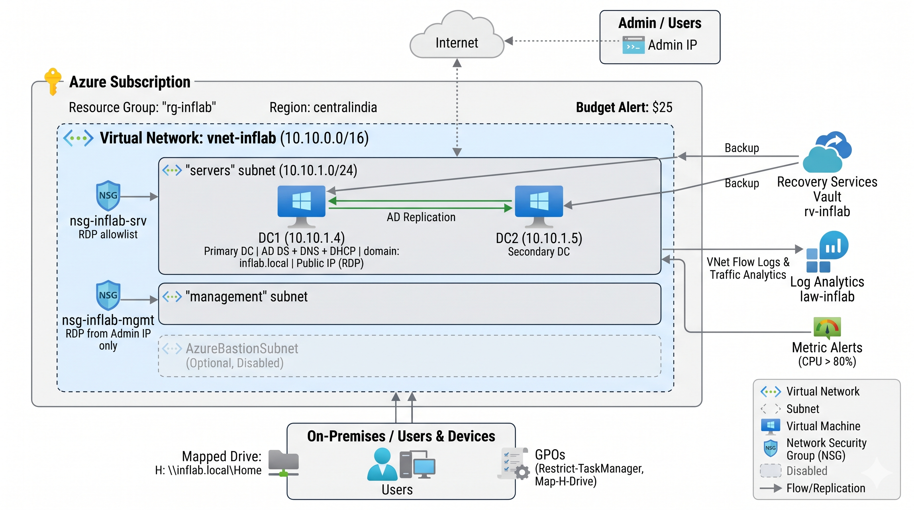
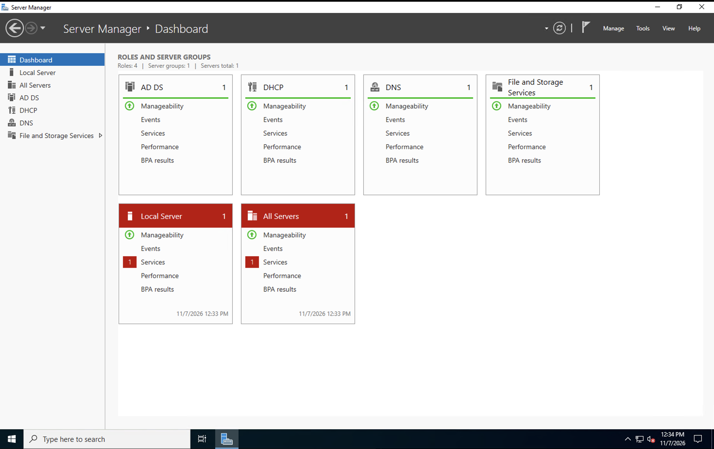
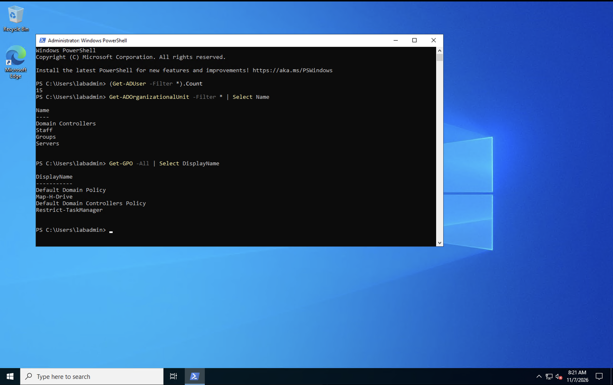
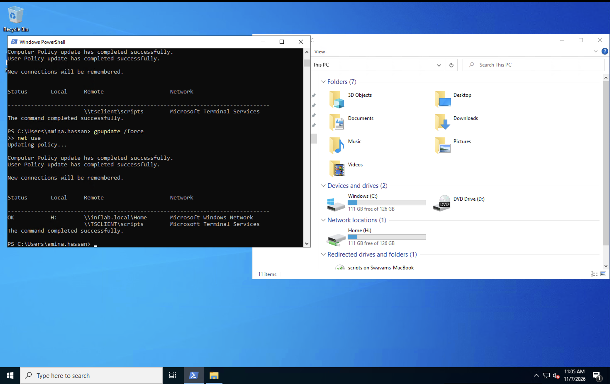
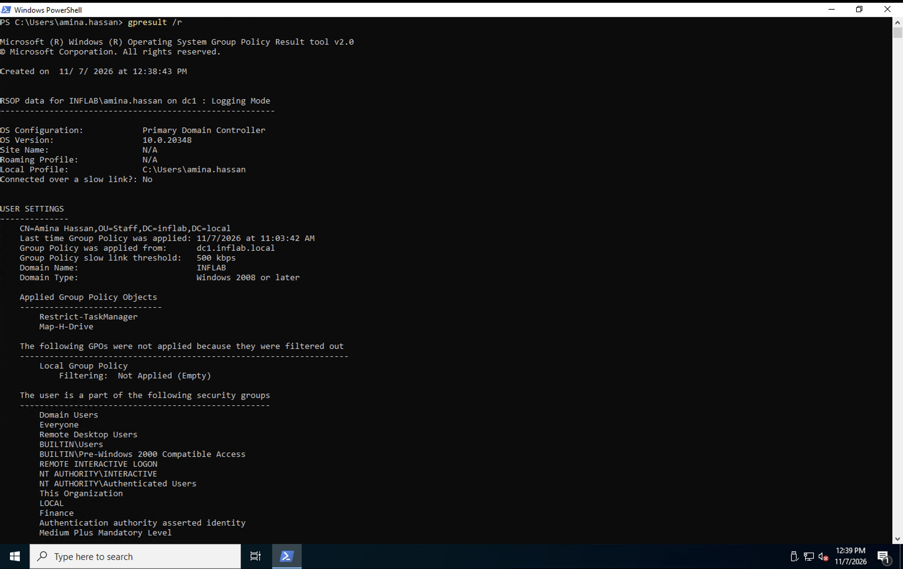
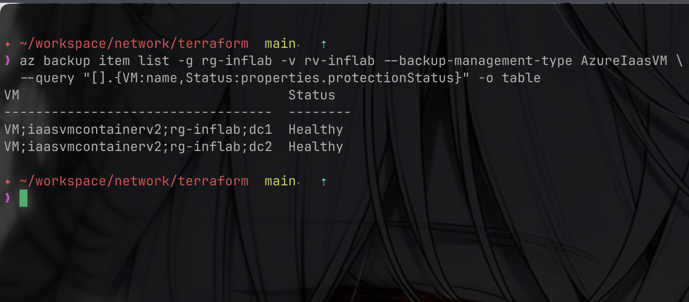
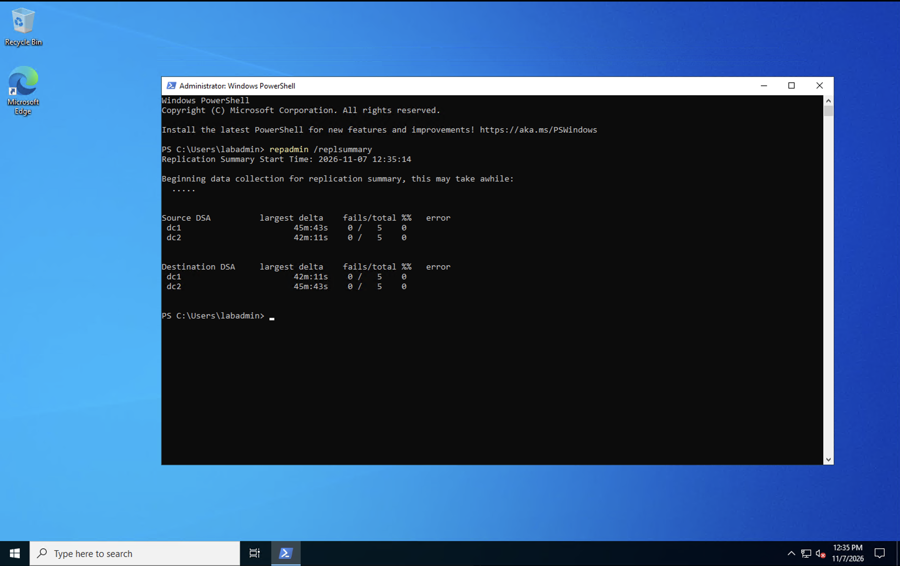
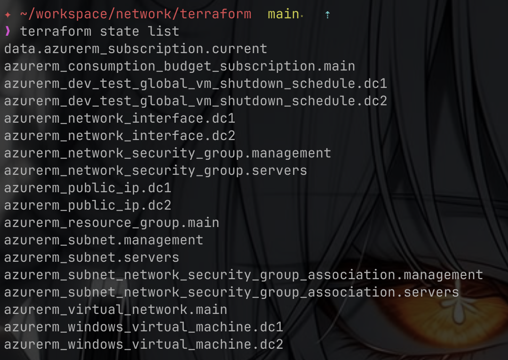

# azure-infra-lab

Azure infrastructure project: network foundation → Windows Server 2022 Active
Directory domain → security hardening, backup & monitoring.

## Architecture

- **Region:** centralindia (policy-restricted subscription)
- **VNet** `10.10.0.0/16` — subnets `servers` (10.10.1.0/24), `management`, `AzureBastionSubnet` (optional)
- **DC1** `10.10.1.4` — AD DS + DNS + DHCP, domain `inflab.local`, 12 users (OU Staff), 4 GPOs
- **DC2** `10.10.1.5` — second DC, healthy replication (0 fails)
- **GPOs:** password policy (min 12), `Restrict-TaskManager`, `Map-H-Drive` (GPP → H: share)
- **Hardening:** SMBv1 off, LLMNR off, audit policy, Defender MAPS advanced, NLA
- **Backup:** Recovery Services vault `rv-inflab`, both DCs protected (daily 23:00)
- **Monitoring:** Log Analytics `law-inflab`, VNet flow logs + traffic analytics, CPU alerts, budget alert

## Diagram



## Screenshots


*Server Manager — AD DS, DHCP, DNS, File Storage green*

| | |
|---|---|
|  |  |
| *Domain: 15 users, OUs (Staff/Groups/Servers), 4 GPOs* | *GPO drive map: `net use` OK + H: in Explorer* |
|  |  |
| *gpresult — Restrict-TaskManager + Map-H-Drive applied* | *Backup — both DCs Healthy* |
|  |  |
| *repadmin — 0 fails both DCs, both directions* | *Terraform state — full IaC resource list* |

## Layout

```
terraform/          # IaC: RG, VNet, NSGs, DC1, DC2, budget alert, auto-shutdown
scripts/            # PowerShell: promote DCs, configure domain, users CSV, GPOs, hardening
runbooks/           # step-by-step guides
docs/               # IP plan, diagram, security report, screenshots
```

## Quick start

```bash
cd terraform && terraform apply          # network + both DCs
# follow runbooks/network.md, then runbooks/active-directory.md
# hardening/backup/monitoring: docs/security.md
```

## Cost

Auto-shutdown 21:30 IST both DCs; deallocate when idle. Teardown order in
[docs/security.md](docs/security.md) → `terraform destroy` + resource cleanup.
